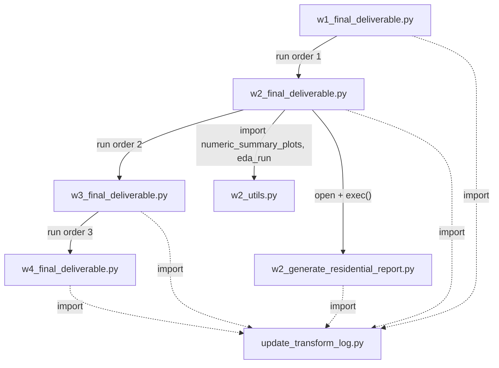
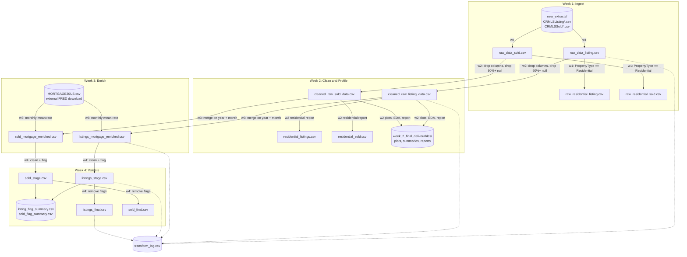

# CRMLS Pipeline: Script Flow and Data Flow

## 1. Overview

The pipeline runs in four stages (Weeks 1–4). Each stage reads the CSV(s) produced by the previous one. Every script also calls `update_transform_log()`, which appends an audit row to `transform_log.csv`.

| Stage | Script | Purpose |
|---|---|---|
| Shared | `update_transform_log.py` | Helper: appends one audit row per transformation to `transform_log.csv` |
| Shared | `w2_utils.py` | Helper: summary plots and EDA functions used by Week 2 |
| Week 1 | `w1_final_deliverable.py` | Ingest monthly extracts, concatenate, add date columns, filter residential |
| Week 2 | `w2_final_deliverable.py` | Drop irrelevant and high-null columns, plots, EDA, then runs the residential report |
| Week 2 | `w2_generate_residential_report.py` | Residential-only filtering and profiling report (called via `exec` from `w2_final_deliverable.py`) |
| Week 3 | `w3_final_deliverable.py` | Enrich with monthly 30-yr mortgage rates |
| Week 4 | `w4_final_deliverable.py` | Validate numerics, dates, and geography; produce final datasets |

---

## 2. Script Flow (which script calls which)

**Run order:** `w1` → `w2` (which internally pulls in `w2_utils` and `w2_generate_residential_report`) → `w3` → `w4`.

Notes on the mechanics:

- `w2_final_deliverable.py` imports `numeric_summary_plots` and `eda_run` from `w2_utils.py`.
- At the end, `w2_final_deliverable.py` reads `w2_generate_residential_report.py` as text and runs it with `exec()`. Because the code runs inside a script whose `__name__` is `"__main__"`, the `if __name__ == "__main__":` block fires and both datasets are processed.
- `update_transform_log.py` is imported by `w1`, `w2`, `w2_generate_residential_report`, `w3`, and `w4`.

---

## 3. Data Flow

The main (critical) path is:

`new_extracts/*.csv` → `raw_data_*.csv` → `cleaned_raw_*_data.csv` → `*_mortgage_enriched.csv` → `*_stage.csv` → `*_final.csv`

The residential files (`raw_residential_*.csv`, `residential_*.csv`) are side branches. Nothing downstream reads them.

---

## 4. Stage-by-Stage Detail

### Week 1: `w1_final_deliverable.py`

| | |
|---|---|
| **Reads** | `new_extracts/CRMLSListing*.csv`, `new_extracts/CRMLSSold*.csv` |
| **Does** | Reads each file (falls back to `latin1` encoding). Adds `filename`, `year`, `month` (regex on the filename), and `download_date`. Concatenates all files per type. Filters `PropertyType == 'Residential'`. |
| **Writes** | `raw_data_listing.csv`, `raw_data_sold.csv`, `raw_residential_listing.csv`, `raw_residential_sold.csv` |
| **Logs** | 4 entries (2 concatenation, 2 residential filter) |

### Week 2: `w2_final_deliverable.py` (+ `w2_utils.py`, `w2_generate_residential_report.py`)

| | |
|---|---|
| **Reads** | `raw_data_listing.csv`, `raw_data_sold.csv` |
| **Does** | 1. Drops irrelevant columns (`LISTINGS_DROP`, `SOLD_DROP`, covering PII, duplicates, and redundant fields).  2. Computes null % per column, saves null-distribution histograms, and drops columns with 90%+ nulls.  3. Saves `cleaned_raw_*_data.csv`.  4. `numeric_summary_plots()` creates histograms, boxplots, and `percentile_summary.csv` for 9 key numeric fields.  5. `eda_run()` prints property-type share, price summary, DOM distribution, above/below list price, date consistency, and top counties.  6. `exec`s the residential report script, which filters to residential, applies sanity filters, and profiles nulls and distributions. |
| **Writes** | `cleaned_raw_listing_data.csv`, `cleaned_raw_sold_data.csv`, `residential_listings.csv`, `residential_sold.csv`, and in `week_2_final_deliverables/`: null-distribution PNGs, `sold_figures/`, `listing_figures/`, `<name>_null_summary.csv`, `<name>_numeric_summary.csv`, `<name>_report.txt` |

Residential report filters, in order:

1. `PropertyType` is `residential` (case-insensitive).
2. `ClosePrice > 0` (sold only).
3. Remove `LivingArea <= 0` (nulls kept).
4. Remove `DaysOnMarket < 0` (nulls kept).

### Week 3: `w3_final_deliverable.py`

| | |
|---|---|
| **Reads** | `MORTGAGE30US.csv` (weekly FRED rates), `cleaned_raw_sold_data.csv`, `cleaned_raw_listing_data.csv` |
| **Does** | Averages weekly rates into monthly values, then left-merges onto sold and listing data by `year` + `month`. Reports unmatched rows. |
| **Writes** | `sold_mortgage_enriched.csv`, `listings_mortgage_enriched.csv` (new column: `rate_30yr_fixed`) |

### Week 4: `w4_final_deliverable.py`

| | |
|---|---|
| **Reads** | `sold_mortgage_enriched.csv`, `listings_mortgage_enriched.csv` |
| **Does** | 1. Converts 4 date columns to datetime, drops duplicates and `Unnamed: 0`.  2. Flags invalid numerics (`ClosePrice <= 0`, `LivingArea <= 0`, `DaysOnMarket < 0`, negative beds/baths), nulls the bad values, and removes those rows.  3. Adds date-order flags (`listing_after_close_flag`, `purchase_after_close_flag`, `negative_timeline_flag`).  4. Adds geo flags (missing, zero, positive longitude, out of state bounds, `invalid_geo_flag`).  5. Saves staging files and flag summaries.  6. Drops the flag columns and saves the final files. |
| **Writes** | `sold_stage.csv`, `listings_stage.csv`, `sold_flag_summary.csv`, `listing_flag_summary.csv`, `sold_final.csv`, `listings_final.csv` |

---

## 5. `transform_log.csv` Schema

Written by `update_transform_log()` (append mode, header created on first write):

`name, action, script_name, num_of_cols, num_of_rows, feature_names, execution_time, destination`

---

## 6. Issues Spotted While Mapping

These affect correctness or traceability. Worth reviewing before relying on the final outputs.

1. **Likely inverted filter in Week 4 (most important).** `sold_final = sold[sold[flag_cols].any(axis=1)]` *keeps* rows that have at least one flag and discards the clean rows. It probably should be `sold[~sold[flag_cols].any(axis=1)]` (same for listings).
2. **Remaining audit columns in final output.** `Invalid_*` and `HasInvalidNumeric` columns don't contain the lowercase string `flag`, so they are not removed with the flag columns and stay in `*_final.csv`.
3. **No-op null handling in Week 4.** `sold_df.dropna(axis=1, how='all')`, `dropna(axis=0, how='all')` and the listings equivalents are never assigned back, so they change nothing.
4. **Extra index column.** Week 3 and Week 4 call `to_csv()` without `index=False`, producing `Unnamed: 0`. Week 4 then has to drop it manually, but `sold_stage.csv` / `listings_stage.csv` are saved with the index again.
5. **Log destinations that don't match actual files.**
   - Week 1 residential entries list `raw_data_sold.csv` / `raw_data_listing.csv` as the destination instead of `raw_residential_*.csv`.
   - Week 2's first log call writes `cleaned_raw_*` as the destination before that file exists.
   - Week 4 logs "Remove invalid numeric values" with the stage path before the stage file is written.
6. **Hard-coded Windows paths.** Week 2 uses `week_2_final_deliverables\...` backslash paths for `savefig` (the folder is only created by `numeric_summary_plots` and the residential report, after the null-distribution plots are saved), which fails on macOS/Linux or if the folder doesn't exist yet.
7. **Residential branches are dead ends.** `raw_residential_*.csv` and `residential_*.csv` aren't read by Week 3 or Week 4, so the final datasets still contain all property types.
8. **Unused constants in `w2_utils.py`.** `LISTINGS_PATH` and `SOLD_PATH` are defined but never used (paths are passed into `eda_run`).
9. **Null % denominator.** Week 2 divides null counts by the row count of the *unfiltered* raw frames (`df_listing.shape[0]`). That's fine here since rows aren't dropped, but it would silently be wrong if row filtering were added before that step.